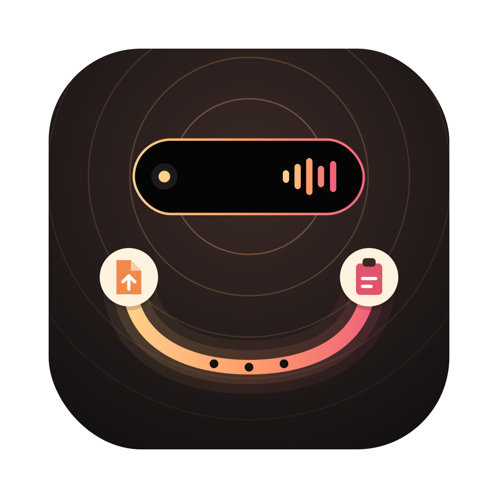
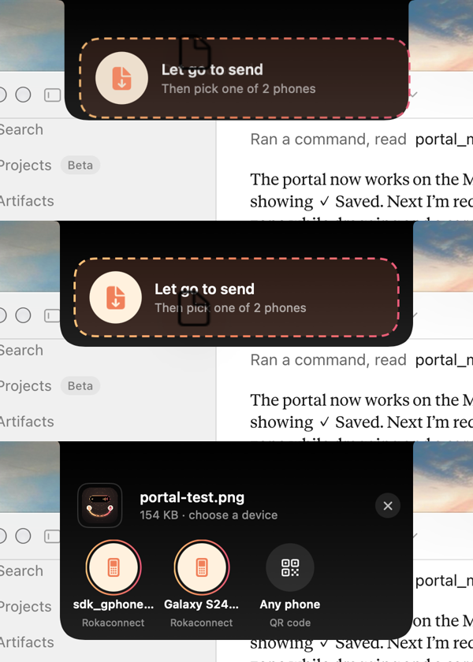
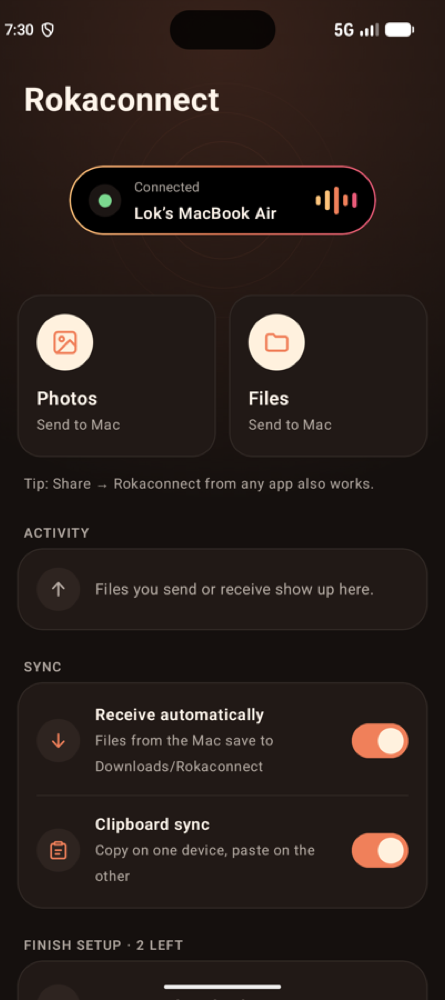
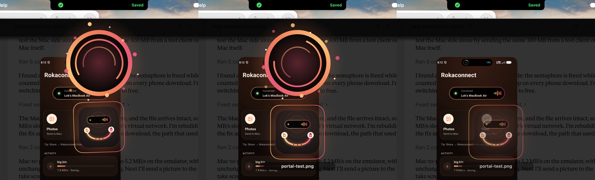

<p align="center">
  
</p>

<h1 align="center">Rokaconnect</h1>

<p align="center">
  A Dynamic Island for the MacBook notch, and a companion Android app that connects your phone and your Mac —
  files, clipboard and music, all over your own Wi-Fi.
</p>

<p align="center">
  
  &nbsp;
  
</p>

---

## What it does

### Mac app (menu bar + notch island)
- **Dynamic Island in the notch.** Hover or click to open; it bounces when something happens.
- **Now Playing.** Artwork, scrolling title, synced lyrics, seek bar and controls for whatever is playing on the Mac.
- **Send by drag and drop.** Drag files onto the notch, then tap your phone.
- **Portal arrival.** Files from your phone come out of a portal under the notch.
- **USB cable mode.** Plug in your Android phone and transfers go through the cable automatically.
  It is about 2× faster than Wi-Fi even on a USB 2.0 cable, and faster still on a USB 3 cable.
- **Clipboard sync.** Copy on the Mac, paste on the phone, and the other way round.
- **Quick Share compatible.** Android phones can send to the Mac with the built-in Share → Quick Share.
- **Extras.** Per-app equalizer, battery and AirPods alerts, weather, an unlock animation, Touch ID lock for Settings.

### Android app
- **Send photos and files** to the Mac in one tap, or with Share → Rokaconnect from any app.
- **Receive automatically.** Files the Mac sends are saved to `Downloads/Rokaconnect`, even with the app closed.
- **Phone island.** A small island around the camera hole that shows music and transfers over any app.
  It finds the camera position by itself, with optional fine-tuning.
- **Clipboard sync** both ways, and a live speed readout while transferring.
- **Uses the USB cable by itself** when the phone is plugged into the Mac (USB debugging on).

<p align="center">
  
</p>

## Privacy

- Everything stays on your local network. There is no server and no account.
- Pairing uses a code from the Mac (scan the QR code). Every transfer is encrypted with AES-256-GCM using a key derived from that code.
- The Android app reads notifications **only** to show the music that is playing. It never reads or sends your notifications.

## Requirements

| | Minimum |
|---|---|
| Mac | macOS 14.2 or later. A notch is recommended. The Liquid Glass look needs macOS 26. |
| Android | Android 10 (API 29) or later |
| Network | Mac and phone on the same Wi-Fi |

## Build from source

### Mac
```bash
./build.sh
```
This builds `build/Rokaconnect.app`. The first build downloads and compiles the open-source
[mediaremote-adapter](https://github.com/ungive/mediaremote-adapter) used for Now Playing. Copy the app to `/Applications`.

Needs Xcode (or the Xcode command-line tools) with Swift 5.9 or later.

### Android
```bash
cd android
./gradlew assembleRelease
```
The APK is written to `android/app/build/outputs/apk/release/`. Needs JDK 17 or later and the Android SDK (compileSdk 36).

## First run

1. Open Rokaconnect on the Mac, then go to **Settings → Portal**. It shows a QR code.
2. Install the Android app and tap **Scan QR code on Mac**.
3. On the phone, finish the short **Setup** list, which turns on only the permissions the island needs.

The Mac app is not notarized, so the first time, right-click it and choose **Open**. On Android, allow the
install when asked (if Play Protect warns, choose *More details → Install anyway*).

## Project layout

```
Sources/Rokaconnect/   Mac app (SwiftUI)
  Island.swift           the notch island
  PortalReceiver.swift   receiving files from the phone + arrival animation
  PortalProtocol.swift   the encrypted Portal wire protocol
  Share/                 drag and drop, Quick Share, USB cable mode
android/               Android app (Kotlin, Jetpack Compose)
tools/                 small helper scripts (icon generation, test client)
docs/                  screenshots
```

## USB cable mode (fastest)

1. On the phone: **Settings → About phone → Software information**, tap **Build number** 7 times,
   then turn on **Developer options → USB debugging**.
2. Install Google's free [platform-tools](https://developer.android.com/tools/releases/platform-tools) (`adb`) on the Mac.
   Rokaconnect finds it in `~/Library/Android/sdk/platform-tools`, Homebrew, or your Downloads folder.
3. Plug the phone into the Mac and tap **Allow** on the phone.

Rokaconnect runs `adb reverse` so the phone reaches the Mac through the cable, using the same encrypted protocol.
Measured on a Galaxy S24 Ultra with the USB 2.0 cable that comes in the box (300 MB file):

| | Speed |
|---|---|
| Wi-Fi | 15.5 MB/s |
| USB cable, phone → Mac | 34.6 MB/s |
| USB cable, Mac → phone | 33.4 MB/s |

That cable is the limit (USB 2.0, 480 Mb/s). A USB 3 data cable lets the phone's USB 3.2 port go much faster.

## Good to know

- **Now Playing** on recent macOS needs a workaround, because Apple restricted its MediaRemote framework.
  Rokaconnect uses the open-source [mediaremote-adapter](https://github.com/ungive/mediaremote-adapter) (BSD-3-Clause).
  A future macOS update could break it.
- **Quick Share** support uses message formats from Google's open-source
  [nearby](https://github.com/google/nearby) and [ukey2](https://github.com/google/ukey2) projects (Apache-2.0).
- macOS does not let apps draw on the lock screen, so the animation plays right after you unlock.

## Author

**Lok Bahadur Roka Magar** — creator, from Nepal 🇳🇵

Facebook [iamlokeshmagar](https://facebook.com/iamlokeshmagar) ·
Instagram [@iamlokeshmagar](https://instagram.com/iamlokeshmagar) ·
TikTok [@lokeshmagar000](https://www.tiktok.com/@lokeshmagar000)

## License

[MIT](LICENSE)
